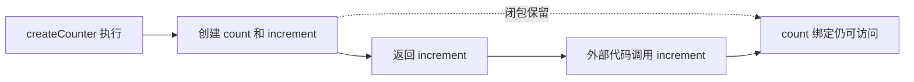

# 闭包

> **快速记忆**
>
> - **核心定义**：闭包 = 函数 + 创建函数时可访问的词法环境。
> - **形成条件**：内部函数被保存到外部后，仍能访问外部变量；外部函数执行结束不代表这些变量立即消失。
> - **常见用途**：保持状态、实现数据私有化、函数工厂和异步回调。
> - **捕获特点**：闭包捕获的是变量绑定（引用），不是创建当时的值快照。

## 一、核心概念

### 1. 闭包是什么

- **定义**：闭包不是一种特殊语法，而是**函数及其创建时能够访问的词法环境的组合**。
- **查找变量**：函数定义时会记录自己的外部词法环境，因此即使函数稍后在其他位置执行，也能按照**定义位置**查找变量。
- **常见表现**：内部函数被返回、赋值给外部变量，或作为回调传递出去；即使外部函数已经执行结束，内部函数仍然可以访问其外部变量。

### 2. 词法作用域

- **决定方式**：词法作用域由代码的**书写位置**决定，与函数最终在哪里调用无关。
- **查找规则**：JavaScript 会先查找当前作用域，再沿着定义时记录的外部作用域逐层查找。
- **关键点**：闭包依赖的是**词法作用域链**，而不是函数调用时在调用栈中的位置。

## 二、闭包如何形成

- **形成过程**：
  1. 外部函数创建局部变量和内部函数。
  2. 内部函数访问外部函数中的变量。
  3. 内部函数被返回或传递到外部，并在之后继续被引用。
- **变量保留**：外部函数执行完毕后，其执行上下文可以销毁；只要内部函数仍然可达，被它引用的**词法环境就会继续保留**。
- **关系图**：



- **计数器示例**：

```js
function createCounter() {
  let count = 0;

  return function increment() {
    count += 1; // 内部函数访问并修改外部变量
    return count;
  };
}

const counter = createCounter();
console.log(counter()); // 1
console.log(counter()); // 2
```

- **运行结果**：`counter` 每次调用都能拿到上一次更新后的 `count`，说明 `count` 被闭包保持了下来。
- **独立环境**：每次调用 `createCounter` 都会创建新的词法环境，因此多个计数器之间的状态互不影响。

## 三、闭包的常见用途

### 1. 保持状态与实现私有数据

- **保持状态**：函数执行结束后，闭包仍然可以读取和修改被捕获的变量。
- **数据私有化**：外部代码只能通过返回的方法读写局部变量，无法直接访问变量本身，从而实现轻量的数据封装。

### 2. 函数工厂

- **作用**：外部函数接收配置，并返回带有固定配置的新函数。
- **示例**：`multiplyBy` 返回的函数会记住本次调用传入的 `factor`。

```js
function multiplyBy(factor) {
  return function (number) {
    return number * factor; // factor 来自外部词法环境
  };
}

const double = multiplyBy(2);
console.log(double(5)); // 10
```

### 3. 事件处理与异步回调

- **延迟执行**：回调函数通常会在当前代码执行完之后才运行。
- **保存上下文**：闭包可以让回调继续使用创建它时的参数、局部变量和配置。
- **常见场景**：定时器回调、事件监听器和网络请求回调。

## 四、循环中的异步问题

- **问题原因**：`var` 是函数级作用域，下面的循环只创建了一个 `i` 绑定。
- **执行时机**：循环会先同步执行结束，定时器回调随后才运行，因此所有回调读取到的都是 `i` 的最终值 `5`。
- **`var` 示例**：

```js
for (var i = 0; i < 5; i += 1) {
  setTimeout(function () {
    console.log(i); // 回调执行时循环已结束，输出 5
  }, i * 100);
}
```

- **`let` 解法**：`let` 具有块级作用域，`for` 循环会为**每次迭代创建新的变量绑定**，回调便能捕获各轮对应的值。

```js
for (let i = 0; i < 5; i += 1) {
  setTimeout(function () {
    console.log(i); // 依次输出 0、1、2、3、4
  }, i * 100);
}
```

- **其他解法**：也可以使用立即执行函数或给回调传入参数，为每轮循环创建独立的变量环境；核心都是让每个回调捕获**不同的绑定**。

## 五、变量捕获与 `this`

### 1. 捕获的是变量绑定

- **捕获内容**：闭包保存的是对**变量绑定**的访问关系，而不是创建时的值快照。
- **读取结果**：变量之后发生变化，闭包读取到的通常也是变化后的值。
- **示例**：

```js
let message = "第一次";

function printMessage() {
  console.log(message);
}

message = "第二次";
printMessage(); // 第二次
```

### 2. 闭包不会自动绑定 `this`

- **职责区别**：闭包解决的是变量访问问题，`this` 的取值仍由函数的**调用方式**决定。
- **固定方式**：需要固定 `this` 时，应使用箭头函数、`bind` 或明确的调用对象，不能仅依赖“函数形成了闭包”。

## 六、内存与使用注意事项

- **生命周期**：闭包会让仍被引用的外部变量保持可达，从而延长相关对象的生命周期，但这**不等于必然发生内存泄漏**。
- **垃圾回收**：当闭包不再被任何对象、事件监听器或定时器引用时，其词法环境通常可以被垃圾回收。
- **及时清理**：长期存在的监听器、定时器或全局缓存若持有闭包，应在不需要时移除监听、清理定时器或解除引用，避免无意中保留大量数据。
- **判断依据**：闭包根据函数的\*\*定义位置（词法作用域）\*\*查找变量，与函数的调用位置无关。
