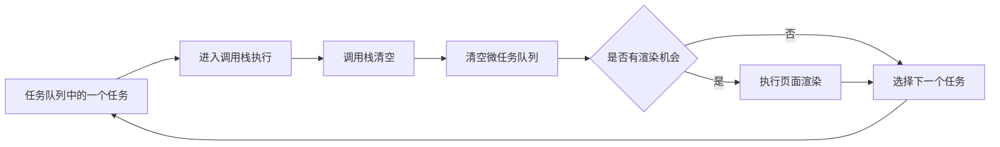

# Event Loop（事件循环）

> **快速记忆**
> - **核心定义**：事件循环是宿主环境协调调用栈、异步能力和任务队列的调度机制。
> - **执行顺序**：执行一个任务 → 清空微任务队列 → 浏览器可能渲染 → 执行下一个任务。
> - **优先级**：当前同步代码执行完后，微任务先于下一个任务执行。
> - **注意事项**：`setTimeout(fn, 0)` 只是尽快排队；Promise 构造器同步执行，`.then()` 回调才是微任务。

## 核心概念

- **JavaScript 单线程**：同一时刻只有一个 JavaScript 执行上下文占用主线程，代码通过**调用栈**执行。
- **异步能力来源**：计时器、网络请求、文件 I/O 等通常由浏览器 Web API 或 Node.js 运行时处理；操作完成后，对应回调才会进入待调度队列。
- **事件循环职责**：当当前任务结束、调用栈清空后，事件循环按照规则选择后续任务执行，并在规定的时机处理微任务。
- **核心目标**：在不阻塞主线程的前提下协调异步操作；但如果 JavaScript 本身执行耗时计算，仍会阻塞事件处理和页面渲染。
- **运行环境差异**：浏览器与 Node.js 都有事件循环，但任务类型、执行阶段和部分优先级规则并不完全相同。

> [!note] 异步不等于并行  
> 异步表示任务可以稍后继续执行，不代表其 JavaScript 回调会同时运行。浏览器内部线程、操作系统或线程池可以并行处理工作，但回调仍要由 JavaScript 线程按顺序执行。

## 浏览器中的执行流程



1. **选择任务**：事件循环从可运行的任务中选择一个执行，例如首次执行的脚本、计时器回调或用户事件回调。
2. **执行同步代码**：任务中的代码进入调用栈，按顺序执行；期间可以注册新的任务和微任务。
3. **清空微任务**：当前任务结束后执行微任务检查点，持续处理微任务，直到队列为空。
4. **尝试渲染**：浏览器可能在微任务清空后更新页面，但**不是每轮事件循环都必然渲染**。
5. **进入下一轮**：浏览器选择下一个可运行任务，重复上述过程。

> [!warning] 微任务饥饿  
> 微任务执行期间新产生的微任务也会在本次检查点继续执行。若不断递归添加微任务，后续任务和页面渲染可能长期得不到执行。

## 任务与微任务

### 任务（Task）

- **常见称呼**：面试中经常称为“宏任务”，但 HTML 规范使用的是 **task**。
- **常见来源**：首次执行的 `<script>`、`setTimeout`、`setInterval`、用户交互事件、`postMessage`、`MessageChannel` 和部分 I/O 回调。
- **调度特点**：每轮通常执行一个任务；浏览器可能维护多个任务队列，并根据任务来源和优先级选择可运行任务，并非只有一个统一的“宏任务队列”。
- **渲染关系**：页面渲染是事件循环中的独立步骤，**不能简单归类为宏任务**。

### 微任务（Microtask）

- **常见来源**：`Promise.prototype.then/catch/finally`、`queueMicrotask()`、`MutationObserver`。
- **`async/await`**：`await` 之前的代码同步执行；函数暂停后，其后续代码通常作为 Promise 反应，在微任务中恢复执行。
- **调度特点**：当前任务结束后、下一个任务开始前，会清空微任务队列。
- **入队顺序**：微任务通常按照入队顺序执行；执行微任务时新增的微任务会追加到队列末尾，并在本轮继续执行。

## 代码执行顺序

```js
console.log(1);

setTimeout(() => {
  console.log(2);
}, 0);

Promise.resolve()
  .then(() => {
    console.log(3);
  })
  .then(() => {
    console.log(4);
  });

queueMicrotask(() => {
  console.log(5);
});

console.log(6);
```

- **同步阶段**：输出 `1、6`，并分别注册一个计时器任务和两个初始微任务。
- **微任务阶段**：先输出 `3`；第一个 `.then()` 完成后，将下一个 `.then()` 回调加入队尾，因此接着输出 `5、4`。
- **下一个任务**：计时器达到最短延迟且被调度后，输出 `2`。
- **最终结果**：`1 → 6 → 3 → 5 → 4 → 2`。

## `setTimeout` 为什么不准时

- **延迟含义**：延迟参数表示回调进入可执行状态前至少要等待的时间，不是保证执行的准确时间。
- **实际执行条件**：计时结束后，回调还要等待当前任务完成、调用栈清空、微任务队列清空，并被事件循环选中。
- **额外限制**：浏览器还可能对嵌套计时器、后台标签页等场景设置最小延迟或节流策略。

## Node.js 中的差异

- **阶段模型**：Node.js 事件循环通常按 `timers`、`pending callbacks`、`poll`、`check`、`close callbacks` 等阶段处理回调。
- **`setImmediate`**：回调在 `check` 阶段执行；它与 `setTimeout(fn, 0)` 的先后顺序受调用上下文影响，不能脱离场景给出固定结论。
- **`process.nextTick`**：它不属于标准 Promise 微任务队列，Node.js 会优先处理 `nextTick` 队列；递归调用同样可能阻塞事件循环。
- **Promise 微任务**：Node.js 也会在适当的执行检查点处理 Promise 回调，但分析题目时还要结合事件循环所处阶段。

## 高频误区

- **“事件循环执行异步代码”**：不准确。异步操作通常由宿主环境处理，事件循环负责安排其后续回调何时进入 JavaScript 调用栈。
- **“微任务始终比宏任务先执行”**：缺少前提。当前正在执行的任务不会被微任务打断；应表述为“**当前任务结束后，先清空微任务，再执行下一个任务**”。
- **“Promise 是完全异步的”**：错误。`new Promise(executor)` 中的 `executor` 立即同步执行，`.then()` 等反应回调才进入微任务队列。
- **“`setTimeout(fn, 0)` 会立即执行”**：错误。它只能在达到最短延迟、当前任务和微任务处理完成后等待调度。
- **“每个宏任务后都会渲染”**：错误。浏览器会根据刷新时机和页面状态决定是否渲染，不保证每轮都发生。
- **“JavaScript 单线程意味着浏览器只有一个线程”**：错误。JavaScript 主线程一次只执行一段代码，但浏览器内部还会使用其他线程或系统能力处理网络、计时、渲染等工作。

## 面试答题模板

- **先说定义**：事件循环是 JavaScript 宿主环境协调调用栈、任务队列和异步能力的调度机制。
- **再说顺序**：一次执行一个任务；任务结束后清空微任务；浏览器随后可能渲染，再选择下一个任务。
- **补充例子**：`setTimeout` 回调属于任务，Promise 的 `.then()` 回调属于微任务，所以同步代码结束后，Promise 回调通常先于计时器回调执行。
- **指出边界**：浏览器和 Node.js 的具体模型不同；遇到 Node.js 题目时还要考虑事件循环阶段、`process.nextTick` 和 `setImmediate`。
