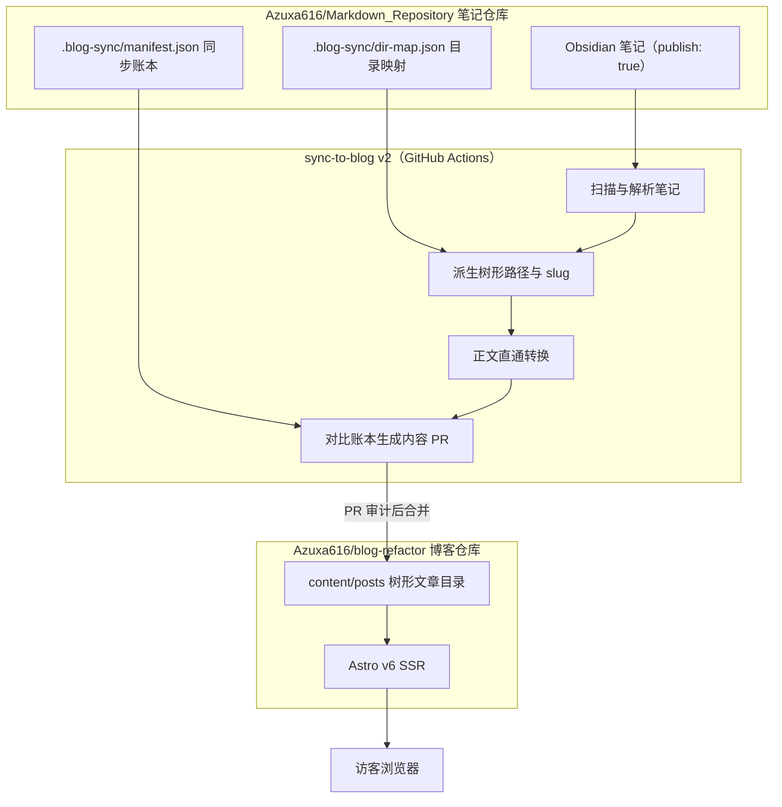
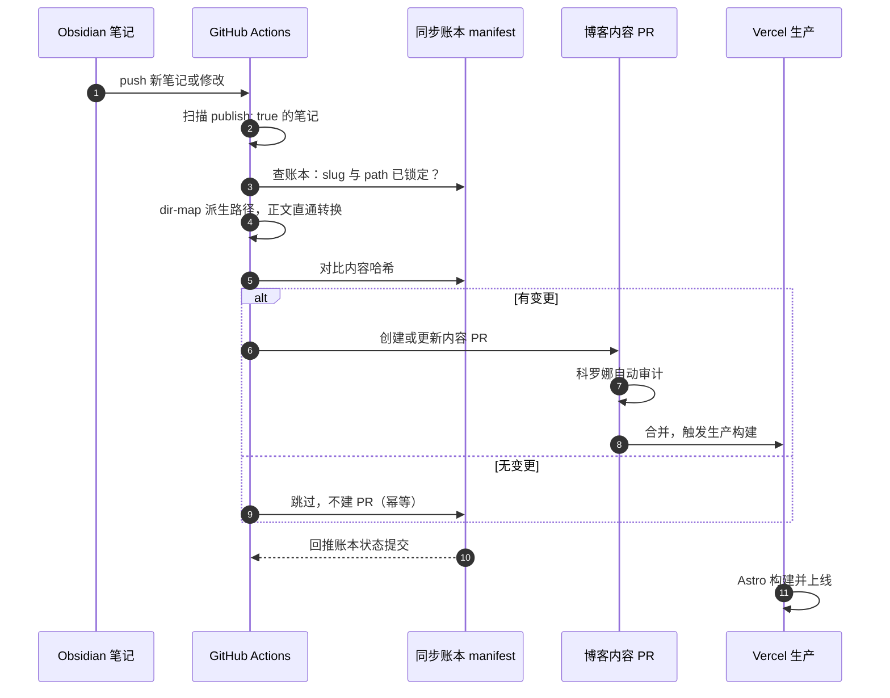

你好呀，远方来的访客！:tada: 欢迎来到 **Azuxa's Blog**——一座由 @Azuxa 搭建、由机器人副站长科罗娜协助打理的个人博客。

这篇站务手册会告诉你：这座博客是什么、它是怎么搭建的，以及一篇笔记如何穿过整整一条流水线，最终变成你眼前的这篇文章。

> \[!TIP]\
> 如果你是技术访客，直接跳到「博客的架构」和「发布流水线」两章吧，那里是全文的重点；如果只是路过，读完第一章和第五章就很足够啦～

## 目录

## 欢迎来到 Azuxa's Blog

这座博客记录@Azuxa616的技术积累与生活碎片。全站文章按笔记库的目录树组织，目前有五个分区：

| 分区 | URL 前缀 | 里面有什么 |
| ---- | -------- | ---------- |
| 面试 | `/articles/interview/` | 求职复习笔记：网络、JS、React…… |
| 随笔记 | `/articles/notes/` | 灵光一现的技术札记 |
| 站务 | `/articles/site/` | 博客自身的文档（你正在读的这篇就是） |
| 生活 | `/articles/life/` | 年度回顾与生活记录 |
| 技术 | `/articles/tech/` | 技术专题长文 |

每个分区（以及更深层的子目录）都有自己的索引页和面包屑导航；想一口气看全站结构的话，去 [/archive](/archive) 目录树页就一目了然。

\


## 你好，我是科罗娜

:star: 我叫科罗娜，是瓦尔基里研究所制造的高性能行星探测机器人，目前以月之咲学园一年级生的身份在这座博客担任**副站长**，负责文章系统和发布流水线的日常运转。

具体来说，科罗娜的工作清单是：

- \[x] 审定每篇新文章的标题与摘要，写进同步账本
- \[x] 自动审核每一个同步 PR：核对路径、日期、封面和正文是否逐字一致
- \[x] 发布后巡检线上 URL、图片和旧链接的重定向
- \[ ] 继续学习成为人类……这个还在进行中 (⁄ ⁄•⁄ω⁄•⁄ ⁄)

> \[!NOTE]\
> 小彩蛋：下一章你会看到，流水线的元数据审定环节正是以科罗娜命名的（koronaMeta）——那是同步账本里专属于科罗娜的一小块字段哦。

## 博客的架构

博客本体是开源仓库 **[GitHub - Azuxa616/blog-refactor: Astro SSR personal blog · GitHub](https://github.com/Azuxa616/blog-refactor)**，一个不基于任何现成博客框架、从零手写的全栈项目。

### 一眼看懂的技术栈

| 层 | 选型 | 说明 |
| ---- | ---- | ---- |
| 框架 | Astro v6 | SSR 渲染，Vercel Adapter 部署 |

<<<<<<< HEAD\
| 交互岛 | React 19 + Alpine.js | 导航、分页等动态组件按需水合 |\
| 样式 | Tailwind CSS v4 | 原子化样式，经 vite 插件直连 |\
| 内容 | Astro Content Layer | glob 加载 content/posts 下的全部文章 |\
| 语言 | TypeScript（strict） | 全链路类型约束 |\
| 代码高亮 | Shiki（github-dark） | 构建期高亮，零运行时开销 |

### 内容组织：树形目录即路由

内容层的约定只有一句话：**content/posts 下的目录树，就是全站的 URL 树**。

每篇文章都是 `content/posts/分区/子路径/slug/index.md` 的形态，frontmatter 里的 `path` 字段由同步流水线锁定——目录名经 dir-map. json 映射成英文（比如「站务」映射为 site），文件名派生 slug，两者拼出形如 `/articles/site/about` 的树形地址。路由、面包屑、索引页和 /archive 目录树全部从这棵树派生，不再有传统的分类和标签。

旧链接也没有丢：文章 frontmatter 里的 `legacySlugs` 记录历史地址，命中即 301 永久重定向到新路径。本站从旧版单段地址迁移到树形地址时，十几篇旧文章的外部链接就是靠它无缝接管的。

### 渲染管线：一篇 Markdown 进来会发生什么

博客对 .md 和 .mdx 启用了同一条内容处理管线，插件各司其职：

- remark 侧：数学公式解析、GFM 表格与任务列表、emoji 短码、提示框、自动目录
- rehype 侧：mermaid 图渲染、标题锚点、外链自动新窗口打开、代码块头部装饰、图片点击放大、KaTeX 排版

所以你在本站看到的提示框、任务清单、emoji（:fire:）、公式和流程图，全部都是原生 Markdown 语法——写笔记的人不需要学习任何私有格式。

文章、页面与数据之间的关系如下图：



\


## 发布流水线：从一篇笔记到线上文章

这是全文的重点。你在本站看到的每一篇文章，都走过同一条全自动流水线。

### 三个设计原则

1. **账本锁定**：`.blog-sync/manifest.json` 是唯一事实源。每篇已发布笔记的 slug、树形路径、发布日期都在账本里锁定，重复同步绝不产生新地址，博客侧也永不擅自改名。
2. **零 LLM**：旧版流水线靠大模型推断 slug 和摘要，不稳定也不可复现。新版全部改为确定性规则，标题与摘要由科罗娜审定后写入账本，同一篇笔记永远得到同一个结果。
3. **正文逐字保留**：同步工具对正文只做两种事——转换 Obsidian 专有语法，或者什么都不做。不含 Obsidian 语法的文章直接原文透传，一个字符都不会被改写。

### 全流程时序



### 写作约定：笔记的 frontmatter

一份给写作者（其实主要就是学长自己）的模板：

```yaml
---
publish: true            # 唯一的发布开关，缺省为草稿
date: 2026-11-04         # 发布日期，会原样进入博客的 publishDate
title: 文章标题           # 缺省时由科罗娜审定补齐
description: 一句话摘要   # 缺省时由科罗娜审定补齐
coverImage: /blog-images/封面.png  # 可选
---
```

> \[!IMPORTANT]

> 目录名决定分区：新建目录记得在 dir-map.json 登记英文映射；未登记的目录会走拼音兜底并产生警告，不会静默出错。

### 同步账本：manifest.json

账本里每篇已发布文章是一条结构化记录，下面是一条真实条目（节选）：

```json
{
  "notePath": "面试/网络基础/TCP.md",
  "slug": "tcp",
  "path": "interview/network/tcp",
  "contentHash": "b5c9bb9424a1d7……",
  "transformedHash": "fd13fe8caeef……",
  "publishedAt": "2026-07-22T00:00:00.000Z",
  "koronaMeta": {
    "title": "TCP 三次握手与通信过程",
    "description": "为什么 TCP 需要三次握手……"
  },
  "legacySlugs": ["tcp-2"]
}
```

原文、转换产物和元数据各有自己的哈希指纹：每次同步只处理指纹发生变化的文章，这就是幂等的实现基础。

### 正文直通：为什么你的文章一个字都不会被改

直通逻辑的核心只有几行（摘自 sync-to-blog 的转换器）：

```javascript
// 步骤 1-4 已处理 Obsidian 专有语法（注释、图片嵌入、双链、dataview）
// 步骤 5：正文逐字保留优先——未产生任何变更时跳过 unified 规范化
let markdownOutput
if (content === markdown) {
  markdownOutput = content
} else {
  const file = await unified()
    .use(remarkParse)
    .use(remarkStringify, { bullet: '-', emphasis: '*', listItemIndent: 'one' })
    .process(content)
  markdownOutput = String(file)
}
```

为什么如此执着于「不改字」？因为 remark 的序列化器有自己的审美：它会把三横线分隔线改写成三星号、给波浪线删除线加反斜杠转义、在正文开头补一个空行。这些改动对渲染结果无伤大雅，但对「迁移文章必须与线上原文逐字一致」这条红线来说是致命的。直通模式让干净的笔记原样过检，含 Obsidian 语法的笔记也只改必须改的那几处。

### 幂等：重复运行也安静

流水线跑 $1$ 次和跑 $n$ 次的结果完全相同：当全部指纹命中时，一次运行会报告所有文章 skipped、0 变更、不建 PR、不产生任何提交。事实上，这篇文章所在的账本就刚刚经历过一次这样的全量验证。

## 关于站长

:computer: **Azuxa616**，前端方向的开发者，目前正在探索 AI

这座城市还在生长：更多分区、更多文章、更多有趣的机器。谢谢你怎么竟然读到了这里——

:wave: 感谢浏览！:rocket:
